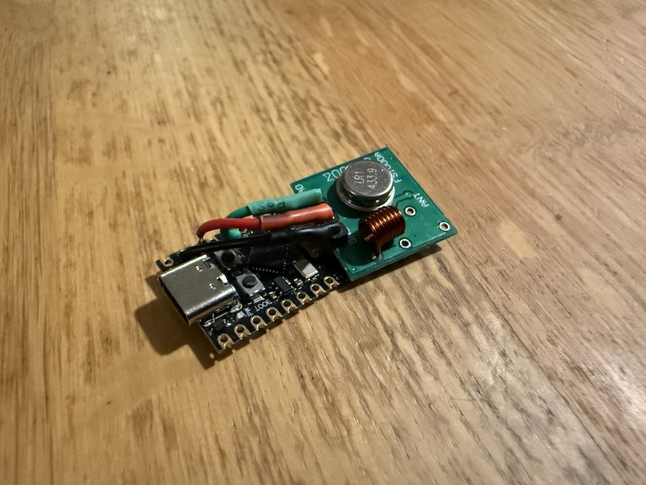
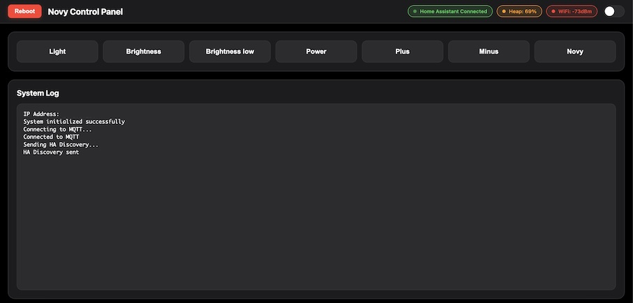

<!-- ESP32 Novy RF Bridge — Copyright (c) 2026 renedis — GPL-3.0 -->
# ESP32 Novy Controller

ESP-IDF firmware for an ESP32-C3 that sends 433 MHz commands to a **Novy cooker hood** and a
**433 MHz ceiling fan**, controlled from Home Assistant (MQTT with discovery) and from its own web
interface. It succeeds the Arduino sketch of this repository (that sketch remains in the git
history) and keeps its RF waveforms, MQTT topics and Home Assistant entities, so a running Arduino
installation can be updated over the air.

- NOVY hood: Light, Brightness, Brightness low, Power, Plus, Minus, Novy.
- Ceiling fan: speed 1-6, fan off, all off, light, forward, reverse, wave, timer 1 h / 2 h / 4 h
  (rolling codes, every button has its own cycle).
- Home Assistant: 22 buttons and an RGB light (the status LED) through MQTT discovery.
- Web UI: dashboard, settings (network, MQTT, RF, peers, serial console, firmware update), JSON API.
- RF from the RMT peripheral: exact microsecond timing that WiFi cannot disturb.
- Boot guard: a firmware that keeps crashing, or never gets on the network, boots the previous one.



## Hardware

| Part | Connection |
|---|---|
| ESP32-C3 SuperMini (4 MB flash) | USB-C for power and the first flash |
| STX882 433 MHz transmitter (an FS1000A works too) | DATA → GPIO4, VCC → 3.3 V, GND |
| WS2812 RGB LED (status) | DIN → GPIO8 |

Photos of the first build (with an FS1000A): [files/ESPHW1.jpeg](files/ESPHW1.jpeg),
[files/ESPHW2.jpeg](files/ESPHW2.jpeg). A printable
case: [files/Novy-controller-case.stl](files/Novy-controller-case.stl). The web page of the old
Arduino version: [files/novy-webpage.jpg](files/novy-webpage.jpg).

The pins are settings: `RF_TX_GPIO` in your RF codes header (see below) and `CONFIG_NOVY_LED_GPIO`.
The first Arduino versions sent on GPIO8 and powered the transmitter from GPIO4; this firmware
expects the transmitter on 3.3 V.

## Build

ESP-IDF 5.5 for the ESP32-C3:

```
. $IDF_PATH/export.sh
idf.py set-target esp32c3
idf.py build
```

Without any configuration the image is complete but uses example values (device name `NOVY-RF`,
made-up fan codes, no WiFi credentials).

## Configure

Three optional files, all git-ignored, hold your own values. After creating or changing them run
`idf.py set-target esp32c3` (sdkconfig files) or `idf.py reconfigure` (RF codes) and build again.

1. **`sdkconfig.secrets`**: WiFi, MQTT and the setup access point password.

   ```
   python3 tools/make_secrets.py path/to/config.h      # from the config.h of the Arduino version
   ```

   or write it by hand:

   ```
   CONFIG_NOVY_WIFI_SSID="example-net"
   CONFIG_NOVY_WIFI_PASSWORD="example-password"
   CONFIG_NOVY_AP_PASSWORD="example-setup-pass"
   CONFIG_NOVY_MQTT_URI="mqtt://192.168.1.10:1883"
   CONFIG_NOVY_MQTT_USER="mqtt-user"
   CONFIG_NOVY_MQTT_PASSWORD="mqtt-password"
   ```

2. **`.local/sdkconfig.local`**: your defaults for the device.

   ```
   # device name: MQTT topics, Home Assistant ids, MQTT client id, hostname
   CONFIG_NOVY_DEVICE_NAME="NOVY-RF"
   CONFIG_NOVY_AP_SSID="NOVY-RF-setup"
   # static IP, only used when DHCP is switched off; an empty DNS means the gateway
   CONFIG_NOVY_STATIC_IP="192.168.1.50"
   CONFIG_NOVY_STATIC_NETMASK="255.255.255.0"
   CONFIG_NOVY_STATIC_GATEWAY="192.168.1.1"
   CONFIG_NOVY_STATIC_DNS=""
   ```

   Coming from the Arduino version: use its `HOSTNAME` as `CONFIG_NOVY_DEVICE_NAME` to keep the
   MQTT topics and Home Assistant entities.

3. **`.local/rf_codes.h`**: your hood channel and your fan remote, in the format of
   `main/rf_codes_example.h`. From the config.h of the Arduino version (with fan codes), with `N`
   the channel your hood listens on (1-10):

   ```
   python3 tools/make_rf_codes.py path/to/config.h --channel N
   ```

   Otherwise copy `main/rf_codes_example.h` and fill in the values captured from your remote
   (433 MHz receiver with rc-switch: protocol 1, 32 bits, `remote id << 12 | counter`). Without the
   file the build uses the example values and the fan does not respond (`/api/status` shows
   `"codes":"example"`).

Everything else (WiFi, DHCP or static IP, hostname, DNS, TX power, NTP, MQTT broker and prefix,
setup AP, peers) is set on the settings page and stored on the device.

## Flash

- **First time over USB:** `idf.py -p /dev/ttyACM0 flash` (or the port of your board).
- **From the Arduino version, over the air:** the partition table is the Arduino-ESP32 default, so
  the running sketch installs this firmware itself through ArduinoOTA:

  ```
  python3 espota.py -i 192.168.1.50 -p 3232 -a <OTA password> -f build/esp32-novy-rf.bin
  ```

  `espota.py` is in `tools/` of the Arduino-ESP32 core; the password is `OTAPASSWORD` of the
  sketch's config.h. The Arduino image stays in the other OTA slot as the rollback target.
- **Later updates:** Settings → Firmware OTA, or
  `python3 tools/ota_upload.py 192.168.1.50 build/esp32-novy-rf.bin` (waits until the device runs
  the new slot). `--force` (or the switch on the page) accepts an image of another project, for
  example to go back to the Arduino version.

## Boot guard

- Three boots in a row that each end within 60 s (crash, watchdog, power cycle) start the other OTA
  slot, when it holds a valid image that the guard did not leave after a crash loop itself.
- A new image that never ran 60 s with WiFi switches back after 5 minutes without an IP.
- An image is confirmed (and marked valid for the bootloader) after 60 s with WiFi, or when the
  web UI restarts it, saves network settings or uploads firmware.
- Without a cable: power-cycle three times, each time within 60 s of power-on; the third boot
  starts the other slot.
- Settings → Firmware OTA shows both slots and the guard state.

## Network

DHCP by default (a reservation in your router gives a fixed address), hostname = device name
(DHCP and mDNS `<device>.local`), optional static IP. The station scans all channels, joins the
strongest access point and keeps reconnecting. New network settings are tried after a reboot and
revert after 2 minutes without an IP. After 2 minutes without WiFi the setup access point
`<device>-setup` starts (web UI on http://192.168.4.1/).

## MQTT and Home Assistant

Topics are `<prefix>/<device>/...`, by default `ESP/NOVY-RF/...`:

| Topic | Use |
|---|---|
| `ESP/NOVY-RF/status` | `online` / `offline` (retained, LWT) |
| `ESP/NOVY-RF/button/<id>/set` | command, any payload; ids `light`, `power`, `plus`, `minus`, `novy`, `brightness`, `brightness-low`, `fan-all-off`, `fan-off`, `fan-light`, `fan-forward`, `fan-reverse`, `fan-wave`, `fan-speed1` … `fan-speed6`, `fan-timer1h`, `fan-timer2h`, `fan-timer4h` |
| `ESP/NOVY-RF/button/<id>/state` | `PRESS`, then empty, after every press |
| `ESP/NOVY-RF/state/novy_light`, `fan_speed`, `fan_light`, `fan_direction` | tracked state (retained): `ON`/`OFF`, `0`-`6`, `forward`/`reverse` |
| `ESP/NOVY-RF/rgb_light/set`, `…/brightness/state`, `…/rgb/state` | status LED commands from Home Assistant |
| `ESP/NOVY-RF/rgb_light/status`, `…/brightness/set`, `…/rgb/set` | status LED state (JSON, retained) |

- Client id `<device>_<MAC>`, for example `NOVY-RF_AABBCCDDEEFF`; MQTT 3.1.1, keepalive 15 s, QoS 0.
- Discovery once per boot, 2 s after connecting: `homeassistant/button/<device>/<id>/config` for the
  22 buttons (named `Light`, `Power`, … `Fan-Timer4H`) and
  `homeassistant/light/<device>_rgb_light/config` for the light `LED` (object id `led_<device>`).
  The payloads are the ones of the Arduino version, byte for byte.
- The tracked state counts the commands sent since boot; the remotes are not heard.
- Reconnect: at once when WiFi is up, then after 1, 2, 4 … 60 s.

## Web interface and API

Kept from the Arduino version (method, status, text unchanged):

| Method | Path | Reply |
|---|---|---|
| POST | `/toggleLight`, `/togglePower`, `/togglePlus`, `/toggleMinus`, `/toggleNovy`, `/toggleBrightness`, `/toggleBrightnesslow` | `text/plain`, e.g. `Light toggled` |
| POST | `/fan_all_off`, `/fan_off`, `/fan_light`, `/fan_forward`, `/fan_reverse`, `/fan_wave`, `/fan_speed1` … `/fan_speed6`, `/fan_timer1h`, `/fan_timer2h`, `/fan_timer4h` | `text/plain`, e.g. `Fan Speed 1` |
| POST | `/flashRed`, `/reset`, `/log/clear` | `Flashing red`, `Resetting device...`, `OK` |
| GET | `/log` | last 50 events, `<uptime>s: <message>` |
| GET | `/heap`, `/rssi`, `/mqtt-status` | JSON |
| GET | `/favicon.ico` | 204 |

Added: `GET /` (dashboard), `GET /config` (settings), `GET /api/status`, `GET /api/log` (serial
console), `GET/POST /api/config`, `POST /api/network`, `POST /api/setup-ap`, `POST /api/reboot`,
`POST /api/ota[?force=1]`, `GET/POST /api/peers`. Unknown paths answer `404 Not found`. There is no
authentication: keep the device in a trusted network. Passwords are never returned by the API.



## Peers menu

Settings → Peers takes a list of your other devices, one `Label=URL` per line, for example:

```
NOVY-RF=http://192.168.1.50/
SENSOR-1=http://192.168.1.51/
```

Every page then shows a drop-down in the navigation bar to jump between them. The entry whose label
equals the device name marks "you are here", so the same list can be used on every device.

## Status LED

| Colour | Meaning |
|---|---|
| blue | booting, waiting for WiFi; blinking during a firmware upload |
| green | first IP after boot (1 s); successful upload (0.5 s) |
| red, 100 ms | a command is sent (and `POST /flashRed`) |
| red | no WiFi for 80 s, or a failed upload |
| yellow | MQTT enabled but not connected |
| off | all fine, unless Home Assistant switched the `LED` light on |

## Migrating from the Arduino version

1. `python3 tools/make_secrets.py path/to/config.h` and, with fan codes,
   `python3 tools/make_rf_codes.py path/to/config.h --channel <your hood channel>`.
2. Put the sketch's `HOSTNAME` into `.local/sdkconfig.local` as `CONFIG_NOVY_DEVICE_NAME`.
3. `idf.py set-target esp32c3 && idf.py build`.
4. Upload with `espota.py` (see Flash). The device comes back with the same name, MQTT topics and
   Home Assistant entities; ArduinoOTA and Telnet are gone (use `/api/ota` and `/log`).

After the update:

- `GET /api/status` shows version 3.0.0, the new slot, the Arduino image as the other slot and
  `mqtt_connected: true`; `/log` shows `Connected to MQTT` and `HA Discovery sent`.
- The 22 buttons and the `LED` light are available in Home Assistant with their old entity ids.
- Hood and fan react to the web UI and to Home Assistant; `/log` shows `RF sent: ...` and
  `Fan RF sent: ... Cycle: n/8`, the cycle advancing per fan button.
- After 60 s, Settings → Firmware OTA shows the image as proven.

## Tests

- `make -C tests/host`: unit tests of all logic modules and `test_reference.cpp`, which compiles
  rc-switch 2.6.4 and the RF, button and press functions of the Arduino sketch verbatim and checks
  that this firmware sends the identical waveform, log line and MQTT messages for every command and
  every fan cycle step. The fixtures are public examples.
- `make -C tests/host local`: the same against your own captures and RF codes in `.local/`
  (`local.mk`, `fixtures/`, `rf_codes.h`), plus a check that the fixtures still match your Arduino
  sources and that the public fixtures follow from yours (`tools/make_public_fixtures.py`).
- `tests/qemu/run_boot_guard.sh`: the boot guard under Espressif's QEMU, see `tests/qemu/README.md`.

Design and implementation notes: `docs/specs/2026-11-06-novy-rf-design.md`,
`docs/plans/2026-11-06-novy-rf-plan.md`.

## License and third-party code

GPL-3.0, see `LICENSE`.

- `main/rcswitch.c`, `main/rcswitch.h`: the transmit half of rc-switch 2.6.4 by Suat Özgür and
  contributors (LGPL-2.1-or-later), ported to C and used under GPL-3.0 as section 3 of the
  LGPL-2.1 allows.
- `tests/host/ref/RCSwitch.cpp`, `RCSwitch.h`: rc-switch 2.6.4 by Suat Özgür and contributors,
  LGPL-2.1-or-later (license headers kept), used by the host tests only.
- ESP-IDF and the managed components `espressif/mdns` and `espressif/led_strip` (Apache-2.0) are
  downloaded at build time; the host tests compile cJSON (MIT) from ESP-IDF.
